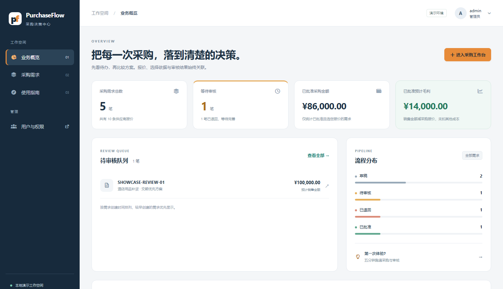
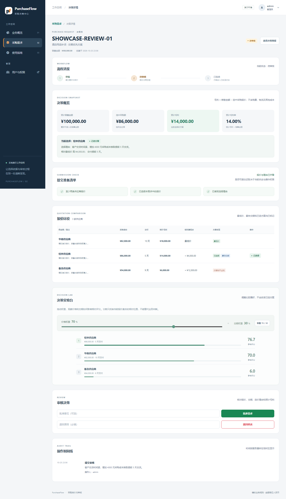

# PurchaseFlow：采购询价与审核工作台

一个可以现场操作的 ABP vNext 业务原型：采购员创建需求并比较供应商报价，审核员退回或批准，系统保存每次决策的记录。它从已有的“销售单 → 采购询价 → 审核 → 利润核算”练习中抽取一段完整流程，展示分层设计、状态规则、权限、数据库约束和可追溯的决策。**规则与数据都是模拟的，不代表任何公司的正式制度。**

项目使用 **.NET 10、ABP 10.6.2、ASP.NET Core Razor Pages、EF Core、SQLite**。这是本地演示版，不是生产部署模板。

## 演示时能看到什么

- **业务总览**：当前租户的需求与报价数量、待审核队列、状态分布、最近需求；采购额和毛利只汇总已批准且选择有效的记录。
- **需求工作台**：状态统计、单号或说明搜索、状态筛选、分页，桌面与手机宽度均可使用。
- **主数据档案**：供应商档案与物料档案支持编码唯一、启用/停用，供应商含账期与评级、物料含规格与单位；报价与需求明细可优先从档案选择，单据仍保存名称/规格快照。查看权限与维护权限分离，演示中只有管理员可维护。
- **报价决策**：比较各供应商报价合计（按需求明细逐项报价自动汇总）、交付天数和预计毛利；选中报价后显示相对最低价的成本差额与交付天数差额，并保留选择理由。
- **提交检查与提醒**：三项准备检查、预计毛利率、最低价/最快交期标签；负毛利与价期均不占优只作提醒，不擅自替用户改变选择。
- **决策实验台**：调整价格与交期权重，在浏览器内比较临时排名；不发送请求、不保存权重、不更改已选方案。
- **打印简报与使用指南**：独立 A4 决策简报包含全部报价、理由、金额与操作历史；系统内指南解释流程、角色和金额口径。
- **状态与权限**：草稿 → 待审核 → 批准或退回；退回可修改后重提，批准后冻结。`buyer` 只负责自己的需求，`reviewer` 负责审核，后端也执行权限与归属检查。
- **可追溯记录**：提交、退回、批准均留下时间、操作人和意见。相同租户的销售单号不能重复，数据库索引也保护这一约束。





预计毛利 = 预计销售金额 − 所选采购报价。报价按需求明细逐项录入成交单价，合计由服务端自动汇总，不再手填总额。例如销售金额 100,000 元，需求明细为办公椅 10 把、会议桌 2 张；A 逐项报价 5,000 / 16,000 元（合计 82,000 元，10 天），B 逐项报价 5,200 / 17,000 元（合计 86,000 元，5 天）；选 B 时预计毛利为 14,000 元，比最低报价多花 4,000 元，交付提前 5 天。页面展示的是决策依据，不把预计毛利称为实际净利润。

实验台将本组金额和天数分别归一化为 0—100 分（越低越好，相同时均为 100），再按权重求和。分数是当前集合的相对比较，不包含质量、服务、合同或供应商信用，增加报价可能改变已有分数。运行时没有 AI 自动选择；项目代码与文档借助 AI 生成和迭代，学习者需要亲手理解与验证。

| 代码位置 | 职责 |
| --- | --- |
| `app/PurchaseFlow/src/PurchaseFlow.Domain.Shared` | 状态、错误码和本地化文案 |
| `app/PurchaseFlow/src/PurchaseFlow.Domain` | 采购需求、报价、审核记录与状态不变式 |
| `app/PurchaseFlow/src/PurchaseFlow.Application.Contracts` | DTO、应用服务接口和权限定义 |
| `app/PurchaseFlow/src/PurchaseFlow.Application` | 用例编排、归属检查、列表查询与报价比较 |
| `app/PurchaseFlow/src/PurchaseFlow.EntityFrameworkCore` | SQLite 映射、唯一索引与 8 个迁移（InitialCreate、HostOrderReferenceUnique、AddPurchaseRequestLines、AddPurchaseOrders、AddGoodsReceipts、AddReceiptConcurrency、AddSupplierQuoteLines、AddMasterData） |
| `app/PurchaseFlow/src/PurchaseFlow.Web` | Razor 页面、表单和响应式界面 |
| `app/PurchaseFlow/src/PurchaseFlow.DbMigrator` | 建库、管理员以及演示角色的初始化 |

## 本机启动

当前这台电脑已经准备好依赖和演示数据库。双击仓库根目录的 `启动项目.cmd`；如果项目已经运行，会直接打开网页；首次启动时，等窗口出现 `Now listening on: https://localhost:44345` 后打开该地址。使用期间保持首次启动的窗口打开，按 Ctrl+C 停止。下面的安装步骤用于在另一台电脑首次配置。

需要 [.NET 10 SDK](https://dotnet.microsoft.com/download/dotnet/10.0)、Node.js、Yarn 和 [ABP CLI](https://abp.io/docs/latest/cli)。仓库中的 `.tools` 是当前机器的临时工具目录，Git 会忽略它；在另一台机器上请安装自己的工具。

```powershell
dotnet tool install -g Volo.Abp.Cli --version 10.6.2
npm install -g yarn
Set-Location app/PurchaseFlow
dotnet restore PurchaseFlow.slnx
Set-Location src/PurchaseFlow.Web
abp install-libs
```

从 `app/PurchaseFlow/src/PurchaseFlow.DbMigrator` 目录执行 `dotnet run`，等待迁移器退出；随后从 `app/PurchaseFlow/src/PurchaseFlow.Web` 目录执行 `dotnet run --launch-profile PurchaseFlow.Web`。网页地址是 [https://localhost:44345](https://localhost:44345)。首次使用本地 HTTPS 时，可以执行 `dotnet dev-certs https --trust`。两个项目的 `Data Source=../../PurchaseFlow.db;` 都依赖上述启动目录，数据库位于 `app/PurchaseFlow/PurchaseFlow.db`。

迁移器会创建 `buyer`、`reviewer`、`receiver` 三个角色并授予相应权限。若想自动创建 `demo.buyer`、`demo.reviewer` 两个用户，在运行迁移器的 **当前 PowerShell 窗口** 中先设置自己的私有密码（`demo.receiver` 使用 `Demo__ReceiverPassword`）：

```powershell
$env:Demo__BuyerPassword = Read-Host '采购员演示密码'
$env:Demo__ReviewerPassword = Read-Host '审核员演示密码'
dotnet run
```

密码只通过本机环境变量提供，不写入仓库；不设置时只创建角色。ABP 模板本地管理员账号是 `admin` / `<local-template-password>`，仅供本机演示。采购员拥有查看、编辑权限，审核员拥有查看、审核权限；审核员不能代替采购员编辑需求。已有的两个演示用户如果已创建，重新运行迁移器不会重置其密码。迁移器还会按编码幂等播种演示主数据：3 家供应商（SUP-001 华东办公家具/A/30 天、SUP-002 南方办公/B/15 天、SUP-003 北方机电/B/45 天）和 4 个物料（MAT-001 办公椅/人体工学/把、MAT-002 会议桌/2.4m/张、MAT-003 深沟球轴承/6205-2RS/个、MAT-004 骨架油封/NBR 20x3/个）。

## 五分钟验收

1. 用采购员或管理员登录，在“采购需求”中创建销售金额 100,000 元的需求。
2. 在“供应商档案/物料档案”确认演示主数据（可选）；为需求录入明细（办公椅 10 把、会议桌 2 张，可关联物料档案），再为两家供应商逐项录入报价单价：A 为 5,000 / 16,000 元（报价合计 82,000 元，10 天），B 为 5,200 / 17,000 元（合计 86,000 元，5 天），供应商可从供应商档案选择；选 B 并填写“交付时间更短”。确认报价合计 86,000 元、成本差额 4,000 元、交付提前 5 天、预计毛利 14,000 元。
3. 提交审核；用审核员退回并填写原因；采购员修改后重新提交；审核员批准。确认记录中能看到操作人、时间和意见，批准后不能再编辑。
4. 新建只含一条报价的需求，确认提交被后端拒绝；尝试重复销售单号，确认得到业务错误。
5. 用管理员打开“供应商档案/物料档案”，新建或编辑一条档案并尝试停用；换业务角色确认只能查看、不能维护。

在 `app/PurchaseFlow` 目录执行 `dotnet test PurchaseFlow.slnx` 运行测试。构建 0 错误、0 警告，112 项测试通过（Domain 43、Application 11、EF Core 50、Web 8），包含 Dashboard 的 SQLite 汇总、队列排序与租户隔离。浏览器另外检查了主要角色操作、创建者归属、退回重提、批准后冻结、表单错误、筛选分页、实验台无请求与选择不变，以及 1440/1280/768/390/360 宽度的六类页面。这些是已测场景，不代表生产级覆盖。

业务约束见 [业务规则](docs/business-rules.md)。优先阅读 [V2 快速学习路线](docs/quick-learning-v2.md)，更长的基础安排见 [五天学习手册](docs/learning-path.md)。

截图中的 `SHOWCASE-REVIEW-01`、`SHOWCASE-RISK-01`、`SHOWCASE-RETURN-01` 是本机准备的模拟记录，数据库不随源码分发；新环境按上述步骤创建自己的记录即可复现流程。

界面基于 ABP Basic 基础资源和项目自定义 Razor 布局、CSS、JavaScript，没有安装 Tabler。若继续定制，可参考 [Tabler 官方仓库](https://github.com/tabler/tabler) 的 Bootstrap 布局组织；引入其代码或资源时遵循对应许可证。

## 边界与后续问题

本项目没有接入真实 ERP 或正式审批制度；供应商/物料档案只是模拟主数据（不含供应商准入、资质与真实账期数据），税费、运费、汇率、库存、金额分级审批和并发编辑都需要业务确认。SQLite 版沿用 ABP 模板的非事务性 Unit of Work 配置；正式数据库需重新验证事务与并发。公开部署前必须替换模板账户、客户端密钥、加密口令和证书，并在源码管理之外配置 `OpenIddict__CertificatePassword`。

